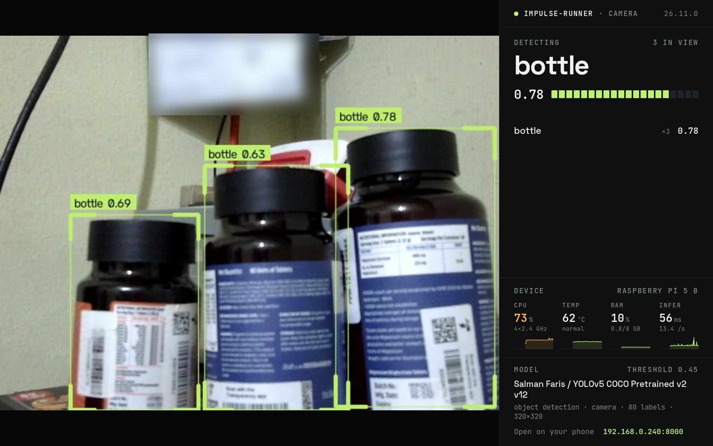

# impulse-runner

[](https://snapcraft.io/impulse-runner)

**Run any Edge Impulse model on Ubuntu Core. Plug and play.**



Export your Edge Impulse project as a Linux `.eim`, drop it into impulse-runner, and it
runs on live data straight away: camera, microphone, or your own sensor readings. No code,
no SDK, no rebuild.

| Your model | Input | What you get |
| --- | --- | --- |
| Image classification | USB / CSI camera | Live video + label scores |
| Object detection (YOLO, SSD, FOMO) | USB / CSI camera | Live video with boxes / centroids |
| Visual anomaly (FOMO-AD) | USB / CSI camera | Live video with anomaly cells + score |
| Audio (keyword spotting, sounds) | Microphone (ALSA) | Live label + level meter |
| Motion / IMU, environmental, fusion | HTTP: you POST readings | Label scores + anomaly score |
| Anything | `POST /api/classify` with raw features | JSON result |

The input is picked automatically from what the model was trained on. Results are served
as JSON and as a web page that [Ubuntu Frame](https://mir-server.io/ubuntu-frame) can show
full screen on an attached display.

> impulse-runner is a community project, not affiliated with or endorsed by Edge Impulse.

## Contents

- [Quick start](#quick-start)
- [Raspberry Pi from scratch](#raspberry-pi-from-scratch)
- [Loading a model](#loading-a-model)
- [Camera models](#camera-models)
- [Audio models](#audio-models)
- [IMU and other sensor models](#imu-and-other-sensor-models)
- [HTTP API](#http-api)
- [Show it on a display](#show-it-on-a-display)
- [Configuration](#configuration)
- [Troubleshooting](#troubleshooting)
- [How it works](#how-it-works)
- [Development](#development)

## Quick start

On Ubuntu Core 22/24 or Ubuntu (arm64 or amd64):

```bash
sudo snap install impulse-runner

sudo snap connect impulse-runner:camera            # camera models
sudo snap connect impulse-runner:alsa              # audio models
sudo snap connect impulse-runner:hardware-observe  # CPU temperature and board name

sudo snap get impulse-runner upload-token          # protects model uploads
```

Open `http://<device-ip>:8000`, click **Load model**, drop in your `.eim` and paste the
token. The model starts within a few seconds.

Check the service with `snap services impulse-runner` and `snap logs impulse-runner -f`.

## Raspberry Pi from scratch

1. **Flash Ubuntu Core.** In [Raspberry Pi Imager](https://www.raspberrypi.com/software/)
   choose **Other general-purpose OS → Ubuntu → Ubuntu Core 24 (64-bit)**. Boot the Pi
   with Ethernet and a screen, and follow the console setup (it imports the SSH keys from
   your [Ubuntu One](https://login.ubuntu.com) account). Then
   `ssh <ubuntu-one-username>@<pi-ip>`.

   For Wi-Fi:

   ```bash
   sudo snap install network-manager
   sudo nmcli d wifi connect "<SSID>" password "<password>"
   ```

2. **Install impulse-runner** with the [Quick start](#quick-start) commands.

3. **Export your model.** In [Edge Impulse Studio](https://studio.edgeimpulse.com), open
   **Deployment**, pick **Linux (AARCH64)** (Raspberry Pi 4/5, Jetson, most arm64 boards)
   or **Linux (x86)** for Intel/AMD, choose **Quantized (int8)** and click **Build**.
   With the Edge Impulse CLI, `edge-impulse-linux-runner --download model.eim` gives the
   same file.

4. **Load it** from the web page, or any of the [other ways](#loading-a-model).

To show the live view on the Pi's own screen, see [Show it on a display](#show-it-on-a-display).

## Loading a model

There's one active model, `/var/snap/impulse-runner/common/model.eim`. Any of these
replace it, and the service picks up the change within 2 seconds:

| How | Command |
| --- | --- |
| Web page | **Load model** button (needs the upload token) |
| HTTP | `curl -X POST -H "X-Upload-Token: $TOKEN" --data-binary @model.eim http://<ip>:8000/api/model` |
| Copy | `sudo cp model.eim /var/snap/impulse-runner/common/model.eim` |
| URL | `sudo snap set impulse-runner model-url=https://example.com/model.eim` |

File permissions are fixed automatically (`cp` and `scp` often drop the exec bit).

To see what a model expects, run `sudo impulse-runner.info`:

```json
{
  "name": "jane / keyword spotting",
  "sensor": "microphone",
  "model_type": "classification",
  "labels": ["helloworld", "noise", "unknown"],
  "input_features_count": 16000,
  "frequency": 16000,
  "suggested_input": "microphone"
}
```

**Upload security.** A model is a program that runs on the device, so uploads need the
token. It's random per install. Change it with
`sudo snap set impulse-runner upload-token=<new>`, or disable uploads with
`upload-token=""`.

## Camera models

Every Edge Impulse image model works: classification, object detection (YOLOv5/8,
MobileNet SSD), FOMO (drawn as centroids) and FOMO-AD visual anomaly (anomalous cells in
red).

Frames are resized the same way Studio does, using the model's resize mode
(`fit-shortest` crop, `fit-longest` letterbox, or `squash`). Grayscale models get
grayscale input. In crop mode, a thin grey rectangle shows what the model sees.

```bash
sudo snap set impulse-runner camera=0                  # /dev/video0 (default)
sudo snap set impulse-runner camera=/dev/video2        # or a path
sudo snap set impulse-runner camera-resolution=1280x720
sudo snap set impulse-runner threshold=0.4             # hide weaker boxes
```

## Audio models

Keyword spotting, sound classification and audio anomaly models use the microphone.
Audio is captured at the model's sampling rate, 16-bit mono, and classified on a sliding
window.

```bash
sudo snap set impulse-runner audio-device=plughw:1,0   # card 1, device 0
sudo snap set impulse-runner audio-overlap=0.75        # more results per second
```

`default` usually works for a single USB or webcam microphone. `cat /proc/asound/cards`
lists the card numbers.

## IMU and other sensor models

Motion, environmental and sensor-fusion models can't know where your sensor is wired, so
you send readings over HTTP from whatever reads it: a script on the device, an ESP32 over
Wi-Fi, Node-RED.

**Stream readings** and let impulse-runner keep the window. Send one row per sample, with
the axes in the same order as in Studio:

```bash
curl -X POST http://<ip>:8000/api/data \
  -H 'Content-Type: application/json' \
  -d '{"values": [[0.12, -0.03, 9.81], [0.15, -0.01, 9.79]]}'
```

```json
{"buffered": 375, "window": 375, "result": {"top": {"label": "wave", "value": 0.91},
 "classification": {"idle": 0.04, "updown": 0.05, "wave": 0.91}, "anomaly": -0.21}}
```

`result` is `null` until the window is full, then refreshes every quarter window. Send
samples at the model's frequency (shown by `impulse-runner.info`). In Python:

```python
import time, requests
HZ = 62.5
while True:
    ax, ay, az = read_my_imu()                    # your sensor code
    r = requests.post("http://localhost:8000/api/data",
                      json={"values": [[ax, ay, az]]}).json()
    if r["result"] and r["result"]["top"]:
        print(r["result"]["top"])
    time.sleep(1 / HZ)
```

To send a whole window at once, use `/api/classify`. It works for every model type.

## HTTP API

| Method | Path | Body | Returns |
| --- | --- | --- | --- |
| GET | `/api/status` | | State, input, model, latest result, FPS, system stats |
| GET | `/api/model` | | Labels, sensor, input size, frequency, all parameters |
| POST | `/api/classify` | `{"features": [...]}` or `1,2,3,...` | One result |
| POST | `/api/data` | `{"values": [[a, b, c], ...]}` | Window fill + result (input `api` only) |
| POST | `/api/model` | raw `.eim`, header `X-Upload-Token` | Loads the model |
| GET | `/frame.jpg?after=<seq>` | | Latest annotated camera frame |
| GET | `/stream.mjpg` | | MJPEG camera stream |

A result:

```json
{
  "top": {"label": "person", "value": 0.82},
  "bounding_boxes": [{"label": "person", "value": 0.82, "x": 212, "y": 64, "width": 180, "height": 390}],
  "classification": {},
  "latency_ms": 61.4,
  "timing": {"dsp": 2, "classification": 57},
  "model_type": "object_detection"
}
```

- Boxes are in camera pixels for camera input, and in model input pixels for
  `/api/classify`. Boxes and `top` are filtered by `threshold`; classification scores are
  always returned in full.
- Image features for `/api/classify` are one integer per pixel (`0xRRGGBB`), row by row,
  at the model's input size, the same as **Raw features** in Studio.
- CORS is open, so pages on other hosts can call the API.

## Show it on a display

```bash
sudo snap install ubuntu-frame wpe-webkit-mir-kiosk
sudo snap set wpe-webkit-mir-kiosk url="http://localhost:8000/?kiosk=1"
```

`?kiosk=1` hides the pointer and the upload button. Ubuntu Frame starts on boot, so the
device boots straight into the live view.

## Configuration

`sudo snap set impulse-runner <key>=<value>`. The service restarts automatically.

| Key | Default | Meaning |
| --- | --- | --- |
| `port` | `8000` | HTTP port |
| `input` | `auto` | `auto`, `camera`, `microphone` or `api` |
| `camera` | `0` | Camera number (`/dev/videoN`) or a `/dev/...` path |
| `camera-resolution` | `640x480` | Capture size |
| `audio-device` | `default` | ALSA capture device, e.g. `plughw:1,0` |
| `audio-overlap` | `0.5` | Audio window overlap, 0–0.95 |
| `threshold` | `0.5` | Minimum score for boxes and the `top` label |
| `model-url` | | Download the model from this URL |
| `upload-token` | random | Token for model uploads. Empty disables them |

| Interface | Needed for |
| --- | --- |
| `camera` | Camera models |
| `alsa` | Audio models |
| `hardware-observe` | CPU temperature and board name |
| `network`, `network-bind` | HTTP (connected automatically) |

## Troubleshooting

| What you see | Fix |
| --- | --- |
| `Model failed to load: model exited with code ...` | Wrong architecture: arm64 needs **Linux (AARCH64)**, Intel/AMD needs **Linux (x86)** |
| `No camera at /dev/video0` | `sudo snap connect impulse-runner:camera`; check `ls /dev/video*`; set `camera=` |
| `Microphone default failed` | `sudo snap connect impulse-runner:alsa`; set `audio-device=plughw:<card>,0` |
| Nothing detected | Lower the threshold (`threshold=0.3`) or improve the lighting |
| `wrong upload token` | `sudo snap get impulse-runner upload-token` |
| Page stuck on "Connecting" | `snap logs impulse-runner -n 100`; check another snap isn't using the port |

## How it works

```
                ┌────────────────── impulse-runner (strict snap) ──────────────────┐
 camera ──V4L2──▶ CameraSource ─┐                                                  │
 mic ────ALSA───▶ MicSource ────┼─▶ features ─▶ model.eim (Unix socket, JSON) ─▶ result
 HTTP POST ─────▶ ApiSource ────┘                                                  │
                │                      HTTP :8000  ◀── browser / Ubuntu Frame / your code
                └───────────────────────────────────────────────────────────────────┘
```

- A `.eim` is a self-contained Linux executable with the DSP and model inside. It answers
  `{"hello":1}` with its parameters (sensor, input size, frequency, labels) and
  `{"classify":[...]}` with results. The official Edge Impulse Linux SDKs use the same
  protocol, so any model works without per-model code.
- The model's sensor and input shape pick the input: image → camera, microphone with a
  sampling rate → microphone, anything else → HTTP.
- The service watches `model.eim` and restarts the model when the file changes.
- The page draws video on a canvas one JPEG at a time, which stays smooth in the WebKit
  kiosk browser.

## Development

Build and install the snap:

```bash
sudo snap install snapcraft --classic
git clone https://github.com/salmanfarisvp/impulse-runner && cd impulse-runner
snapcraft pack
sudo snap install --dangerous ./impulse-runner_*.snap
```

On a Mac, build inside a Multipass VM (`multipass launch 24.04 -n snapbuild`).

Run it without a snap (macOS or Linux):

```bash
pip install numpy opencv-python-headless
mkdir data && cp ~/Downloads/model.eim data/      # a .eim for your machine
PORT=8000 UPLOAD_TOKEN=dev python3 src/impulse_runner.py
python3 tests/test_runner.py                      # uses a fake .eim, no model needed
```

`tests/fake_eim.py` stands in for a real model (camera, audio or IMU, set with
`FAKE_KIND`).

**Releases** use CalVer `YY.MM.N` (`26.11.0` is the first release of November 2026). Bump
`version` in `snap/snapcraft.yaml`, add a matching section to `CHANGELOG.md`, then tag:

```bash
git commit -am "Release 26.11.4"
git tag v26.11.4 && git push origin main v26.11.4
```

CI builds amd64 and arm64 snaps and creates a GitHub Release with the changelog section as
notes.

## License

Apache-2.0. Your models are yours. Check the license of any pretrained model you deploy
(for example, YOLOv5 weights are AGPL-3.0).
